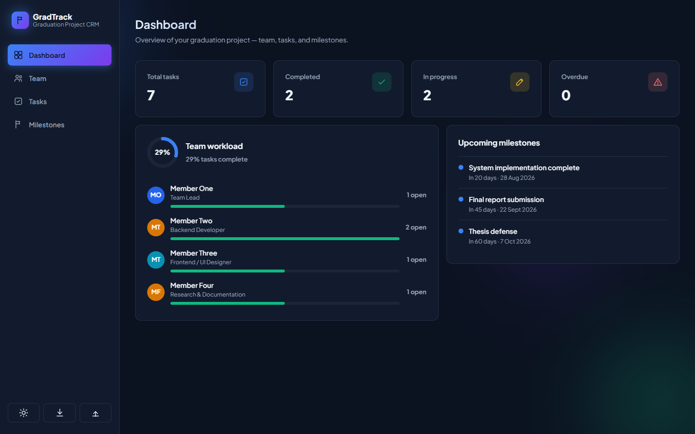
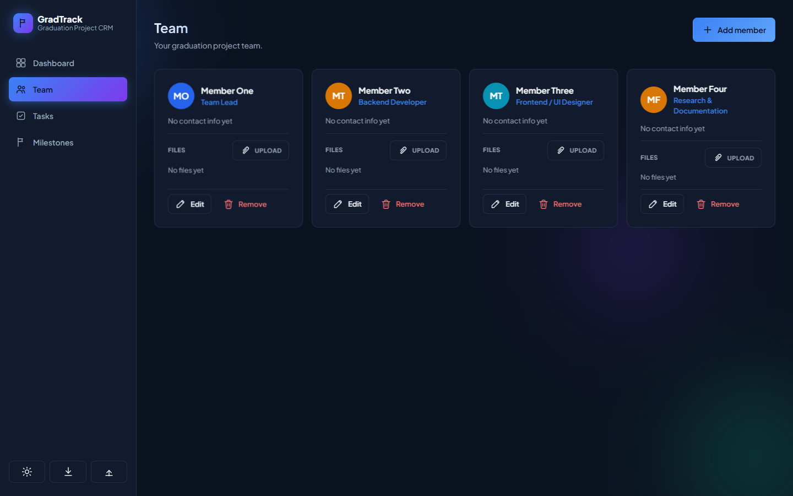
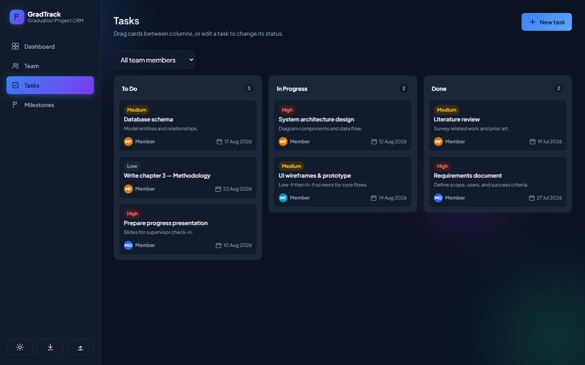
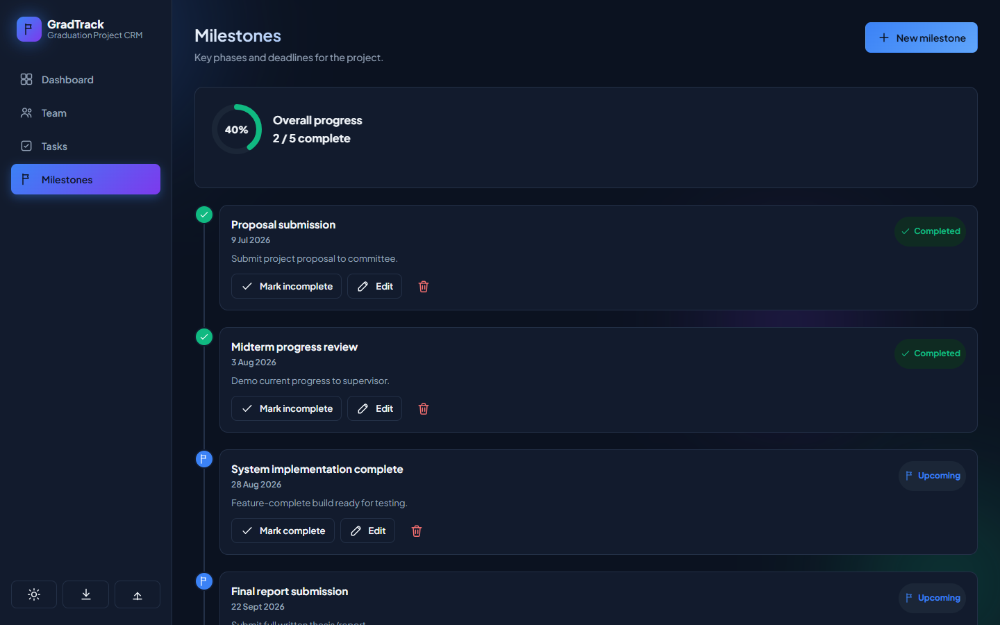

# GradTrack — Graduation Project CRM


A full-stack team CRM — kanban task board, milestone tracking, team file uploads — built as a real client/server app so a whole team shares one live source of truth instead of everyone having their own local copy.

**[→ Try the live app](https://gradtrack-crm.onrender.com)** &nbsp;·&nbsp; hosted free-tier, first load after idle takes ~50s to wake up



## Highlights

- **Real backend, not a mock** — Express REST API backed by SQLite (`node:sqlite`, zero native dependencies to compile/deploy), with real multipart file uploads stored on disk
- **Hand-built animation system, no UI framework** — sliding gradient nav indicator, animated SVG progress rings, 3D tilt-on-hover cards, a circular "iris" theme-switch transition via the View Transitions API, and confetti on milestone completion — all vanilla CSS/JS, `prefers-reduced-motion` respected throughout
- **Optimistic UI** — drag-and-drop and toggle actions update instantly and roll back automatically if the API call fails
- **~1,650 lines, zero frontend dependencies** — the entire client is one self-contained HTML file talking to the API over `fetch`
- **Deployed with CI-style auto-deploy** — pushes to `main` redeploy automatically on Render

## Screenshots

| Team | Tasks (kanban) |
|---|---|
|  |  |

| Milestones |
|---|
|  |

## Stack

- **Backend:** Node.js + Express, using Node's built-in `node:sqlite` (no native build tools required)
- **Frontend:** Single static HTML/CSS/vanilla JS page (`public/index.html`), talks to the backend over a REST API
- **File uploads:** stored on disk under `data/uploads/`, metadata in SQLite
- **No login** — anyone with the URL can view and edit (fine for a small trusted team; see "Adding access control" below if you want to lock it down later)

## Run it locally

Requires Node.js **22.5+** (uses the built-in `node:sqlite` module — no native compilation, so no Visual Studio Build Tools or similar needed).

```bash
npm install
npm start
```

Then open **http://localhost:3000**. Data is stored in `data/gradtrack.db` (created automatically, gitignored). Delete that folder any time to reset to the seed data.

## Deployment

Already deployed on [Render](https://render.com) at [gradtrack-crm.onrender.com](https://gradtrack-crm.onrender.com), auto-connected to this repo's `main` branch — every push to `main` triggers a redeploy.

To set it up again elsewhere (or for your own fork):

1. Push this project to a GitHub repo.
2. Go to [render.com](https://render.com) and sign up / log in (free tier works).
3. **New +** → **Web Service** → connect your GitHub account → pick the repo.
4. Build Command: `npm install` · Start Command: `npm start` · Instance Type: Free.
5. Click **Create Web Service**.

<details>
<summary><strong>Note on data persistence on Render's free tier</strong></summary>

Render's **free** web services do not guarantee the disk survives across redeploys or restarts (a fresh deploy/restart can start with an empty filesystem, wiping `data/gradtrack.db` and all uploaded files). This is fine for a demo/presentation, but if you want the team's data to survive long-term, either:

- Upgrade to a paid **Starter** instance (~$7/mo) and attach a **Render Disk** mounted at `/opt/render/project/src/data`, or
- Wire the app up to a free external database (e.g. Turso or a free Postgres like Neon/Supabase) instead of local SQLite, for real durability without paying for a disk.

</details>

## API overview

| Method | Path | Description |
|---|---|---|
| GET | `/api/data` | Full snapshot: `{ team, tasks, milestones }` |
| POST | `/api/team` | Create team member |
| PUT | `/api/team/:id` | Update team member |
| DELETE | `/api/team/:id` | Remove team member (unassigns their tasks) |
| POST | `/api/team/:id/files` | Upload files (multipart, field name `files`, max 5MB each) |
| DELETE | `/api/files/:id` | Remove an uploaded file |
| POST/PUT/DELETE | `/api/tasks[/:id]` | Task CRUD |
| POST/PUT/DELETE | `/api/milestones[/:id]` | Milestone CRUD (`completed` boolean on PUT) |
| POST | `/api/import` | Replace all data (used by the Import button) |

## Adding access control later

Currently anyone with the link can view/edit everything. If you later want a shared team password or per-member logins, that's a scoped addition to the Express backend (a login route + session cookie) — ask and it can be added without disrupting the rest of the app.
